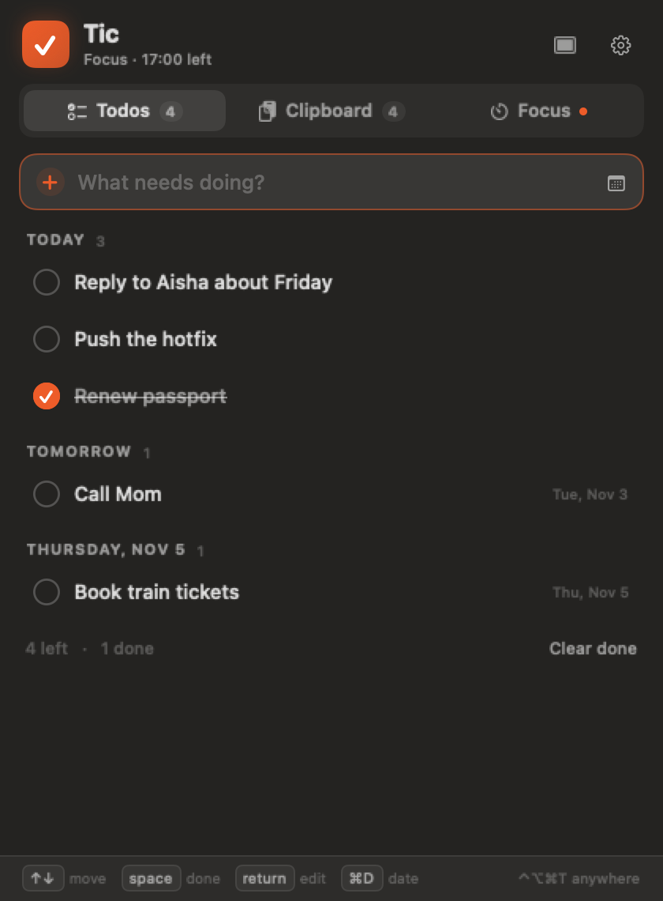
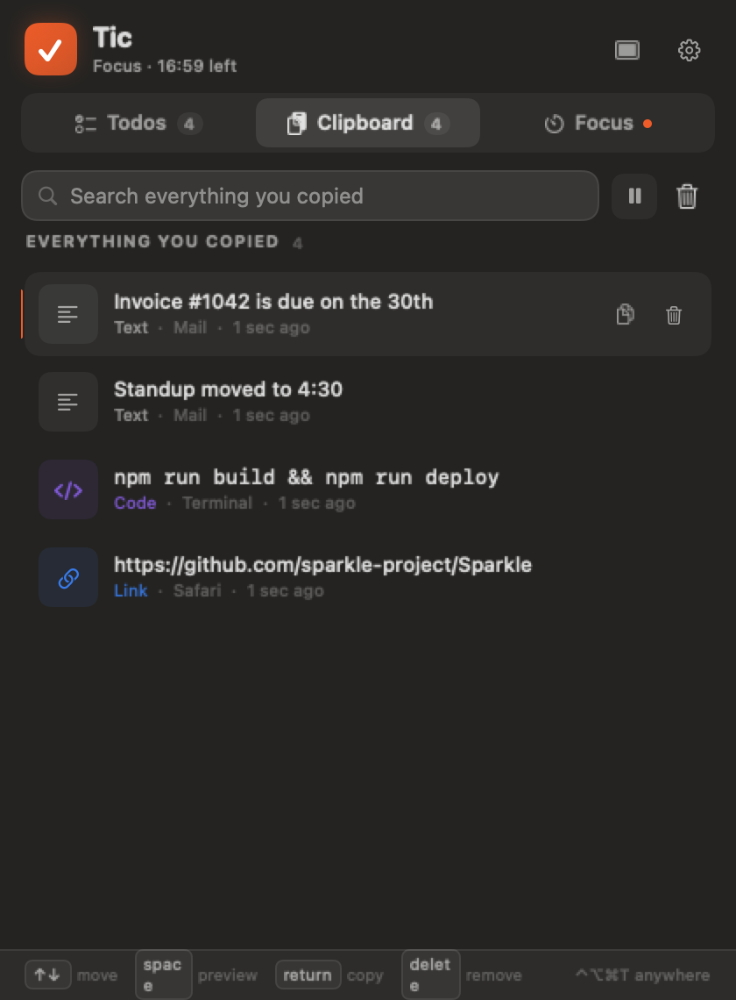
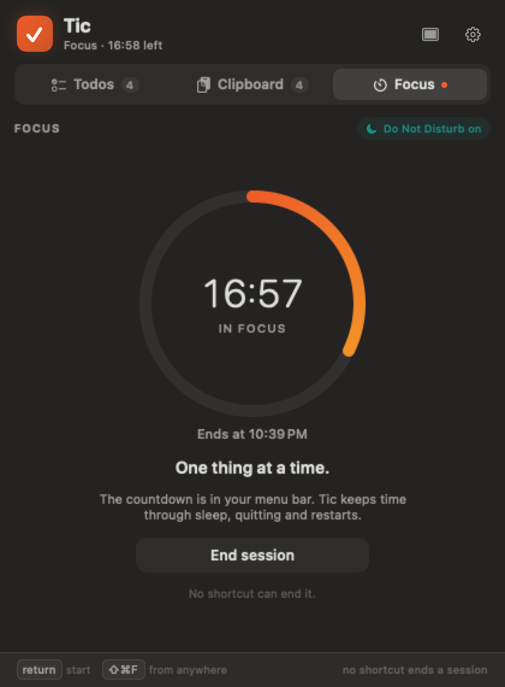

# Tic

**[Download for macOS](https://github.com/MlLearnerAkash/tic/releases/latest)** · **[Website](https://mllearnerakash.github.io/tic/)**

A native macOS menu-bar app with three tools in one icon:

- **Todos** — today first, dated lists, drag to reorder, confetti when you finish something.
- **Clipboard history** — text, links, code, images and files, with source app and time. Search, preview, copy back, pause, clear. Passwords are skipped.
- **Focus** — a countdown in the menu bar, Do Not Disturb through Shortcuts, a soft chime, and sessions that survive sleep, quit and restart.

No account. No cloud. No analytics. Data lives in `~/Library/Application Support/Tic/` and exports as a single JSON file with images included.

<p align="center">
  
  
  
</p>

> Tic is an original, feature-matched implementation inspired by the product at tocal.app. It is not affiliated with that product and does not copy its assets or code.

## Install

Download `Tic-1.0.dmg` from [Releases](https://github.com/MlLearnerAkash/tic/releases), open it, and drag **Tic** into **Applications**.

The app is ad-hoc signed, not notarized. On first launch macOS may block it. Either right-click the app and choose **Open**, or clear the quarantine flag:

```sh
xattr -d com.apple.quarantine /Applications/Tic.app
```

## Build

Requirements: macOS 14+, Xcode Command Line Tools (Swift 5.9+). Full Xcode is not required.

```sh
cd tic
./scripts/build-app.sh
open build/Tic.app
```

The build produces `build/Tic.app`, ad-hoc signed so it runs locally. To install:

```sh
cp -R build/Tic.app /Applications/
```

To package a drag-to-install disk image:

```sh
./scripts/make-dmg.sh
# -> build/Tic-1.0.dmg (+ .sha256)
```

## First run

Tic has no Dock icon. Look for the ✓ in the menu bar.

- Click it, or press **⌃⌥⌘T** anywhere.
- **⇧⌘F** opens Focus, ready to start.
- **⌘O** opens the full window.
- **⌘1 / ⌘2 / ⌘3** switch Todos / Clipboard / Focus.
- **⌘,** opens Settings.
- Deep links: `tic://todos`, `tic://clipboard`, `tic://focus`, `tic://focus/start`, `tic://window`, `tic://settings`.

### Focus mode and Do Not Disturb

macOS has no public API for an app to toggle Focus directly. Tic uses two Shortcuts you create in the Shortcuts app:

1. Open Shortcuts → create a shortcut named **Tic Focus On** that sets a Focus mode on.
2. Create **Tic Focus Off** that turns it off.

If the names differ, change them in Settings → Focus mode. Tic checks the exit status of each shortcut and only turns off a mode it turned on. Without the shortcuts, the timer still works; only the automatic Do Not Disturb toggle is skipped.

### Clipboard privacy

Tic skips the pasteboard when it carries a private/concealed marker used by password managers. It also never records when the frontmost app is a known password manager (1Password, Bitwarden, LastPass, Dashlane, KeePassXC, Enpass, NordPass, Proton Pass, Apple Passwords/Keychain and others). This is deliberately conservative: if an app marks a copy as private, Tic ignores it.

## Features

### Todos
- Add with Return, cursor starts in the field.
- Today, Tomorrow and each upcoming day; overdue is called out.
- ⌘D date picker, including any future day.
- Drag to reorder, or drag onto another day to move it there.
- Space completes, Return edits, Delete removes, ↑/↓ moves.
- Confetti, remaining/completed counts, clear completed.

### Clipboard
- Captures text, links, code, images and files.
- Stores the source app and time; copying the same thing again moves it to the top and increments a count.
- Search across content, file names, source app and kind (“images”, “code”, …).
- Space opens a preview with selectable text, a larger image, or file paths.
- Return or double-click copies back. Pause recording. Clear today / 7 days / 30 days / everything.
- No automatic deletion and no item cap.

### Focus
- 25 / 50 / 90-minute presets plus any custom length from 1 minute to 24 hours.
- Countdown replaces the menu-bar icon.
- DND on through Shortcuts, chime at the end, then DND off.
- Timer is derived from the start timestamp, so sleep, quit and restart don't stop it.
- No keyboard shortcut can end a session. Ending is a confirmed button click.

### Desktop
- Menu bar popover plus a full window (⌘O).
- Keyboard-first throughout.
- Light, dark and system appearance.
- Launch at login.
- Export/import JSON (import only adds, never overwrites).
- Menu bar right-click: open, settings, pause clipboard, quit.

## Project layout

```
Sources/Tic/
  TicApp.swift          App delegate, status item, popover, windows, snapshots
  AppState.swift        State, persistence triggers, actions
  Models.swift          Todos, clipboard items, focus, settings
  Storage.swift         JSON store, images, export/import
  ClipboardMonitor.swift Pasteboard polling, classification, privacy filters
  HotKeyManager.swift   Carbon global hotkeys
  DNDController.swift   Shortcuts runner
  LaunchAtLogin.swift   SMAppService + LaunchAgent fallback
  MenuBarView.swift     Popover + full window shell
  TodosView.swift
  ClipboardView.swift
  FocusView.swift
  SettingsView.swift
  Theme.swift           Design tokens and shared components
Resources/Info.plist
scripts/build-app.sh
```

## Notes and limits

- The app is ad-hoc signed. Apple notarization and a Developer ID signature require an Apple Developer account and credentials; that step is not included.
- Payments/licensing, a marketing site, a Sparkle update feed and a macOS 26 Liquid Glass build are distribution/product pieces, not local app code. Everything the app itself does is implemented here.
- Tic is intentionally not sandboxed because it launches the `shortcuts` CLI and reads the system pasteboard broadly. The app never makes network requests.
- A hidden snapshot mode exists for development: `TIC_RENDER_SNAPSHOTS=1 TIC_DEMO=1 build/Tic.app/Contents/MacOS/Tic` writes PNGs of every screen to `/tmp/tic-*.png` and exits.
